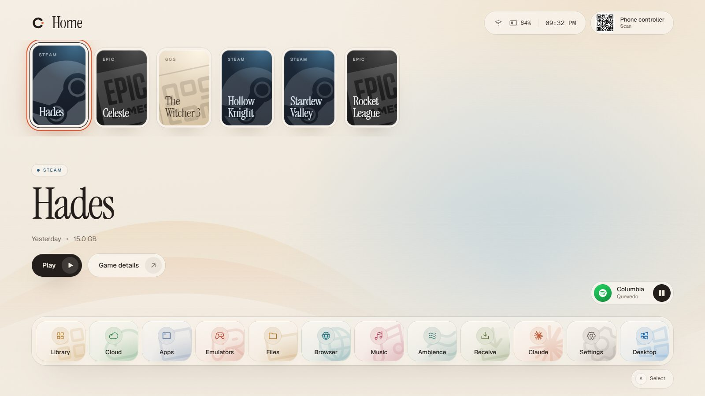

<div align="center">

[English](README.md) · [Español](README.es.md) · [Português (Brasil)](README.pt-BR.md) · [Français](README.fr.md) · **Deutsch** · [Italiano](README.it.md)

<br>

<picture>
  <source media="(prefers-color-scheme: dark)" srcset="brand/final/lockup-reversed.svg">
  
</picture>

### Kostenloser Open-Source-Konsolenmodus für Windows 10 und 11

Spiele von Steam, Epic, GOG und Xbox in einer Bibliothek, Xbox Cloud Gaming und PS5 Remote Play, Emulatoren und Streaming-Apps, alles bedienbar vom Sofa aus mit Controller, Tastatur oder Handy.

[](https://github.com/pablonolascoo/couchdesk/releases/latest)
[](https://github.com/pablonolascoo/couchdesk/releases)
[](LICENSE)
[](https://github.com/pablonolascoo/couchdesk/releases/latest)
[](https://github.com/pablonolascoo/couchdesk/stargazers)

[**Für Windows herunterladen**](https://github.com/pablonolascoo/couchdesk/releases/latest) · [Website](https://pablonolascoo.github.io/couchdesk/de/) · [Änderungsprotokoll](CHANGELOG.md)



</div>

## Was es ist

CouchDesk ersetzt den Windows-Desktop durch einen Bildschirm im Konsolenstil, wie bei einer PS5 oder Steam Big Picture. Vom Sofa aus spielst du, schaust Serien und änderst Einstellungen, ohne die Maus anzufassen. Wenn du willst, startet der PC direkt darin statt auf dem Desktop.

Es ist kostenlos, ohne Konto, ohne Werbung und ohne Telemetrie.

## Funktionen

| | |
|---|---|
| **Eine Spielebibliothek** | Steam, Epic, GOG und Xbox / Game Pass zusammen. Spiele von EA, Ubisoft, Battle.net und anderen Launchern kommen aus dem Startmenü: Drücke „Als Spiel markieren“. |
| **Alle deine Apps** | Alles, was auf dem PC installiert ist, mit seinem echten Symbol. |
| **Cloud-Gaming** | Xbox Cloud Gaming im Vollbild und PS5 Remote Play mit [chiaki-ng](https://github.com/streetpea/chiaki-ng). |
| **Emulatoren** | Mit einem Klick installiert und aktualisiert, mit Ordnern für Spiele, BIOS und Spielstände je Emulator, und Rückkehr zur Vorversion, wenn eine neue Version Probleme macht. |
| **Browser mit Controller** | 24 Streaming-Verknüpfungen: Netflix, Prime Video, Disney+, HBO Max, DAZN, Movistar Plus+, YouTube, Twitch, Spotify und mehr. Zum Beenden Esc halten oder die Xbox-Taste drücken. |
| **Handy als Controller** | Scanne einen QR-Code, und dein Handy wird zu Gamepad, Touchpad oder Tastatur. Es wechselt den Modus selbst. |
| **Echte Controller** | Xbox, PS4 und PS5, per Kabel oder Bluetooth, alle gleichzeitig. Das PlayStation-Touchpad funktioniert als Maus. Profile für die Tastenbelegung und eine Bildschirmtastatur. |
| **Musik** | Spotify oder jeder Player: aktueller Titel, Wiedergabe/Pause, Weiter und Lautstärke pro App, auch per Sprache. |
| **Claude eingebaut** | Der Assistent Claude mit Sprache, gespeicherten Gesprächen, Konnektoren (MCP) und Erweiterungen, in einem schwebenden Fenster über deinem Spiel. |
| **Hintergründe und Themes** | Animierte Hintergründe im PS5-Stil oder dein eigenes Bild, Video, YouTube-Link oder 3D-Modell. Eingebaute Themes, oder erstelle eigene mit Menümusik. |
| **Bildschirmschoner und Ambiente-Modus** | Bildschirmschoner im Apple-TV-Stil mit Uhr, Datum und Wetter, Energiesparmodus, und er kann den von Windows ersetzen. Videos von Kamin, Wasserfall und Regen. |
| **In CouchDesk starten** | Starte den PC in CouchDesk statt auf dem Windows-Desktop und geh mit einem Knopf zurück. |
| **Dateien** | Ein Datei-Explorer, und Dateien von deinem Handy oder einem anderen PC per Browser-Upload, FTP oder LocalSend direkt in die Emulator-Ordner empfangen. |
| **Windows-Einstellungen** | Ton, Helligkeit, Energie und WLAN mit dem Controller. |
| **Sprachen** | Spanisch, Englisch, brasilianisches Portugiesisch, Französisch, Deutsch und Italienisch, mit Übersetzungen aus der Community. |

## Warum CouchDesk?

| | CouchDesk | Xbox-Modus | Steam Big Picture | Playnite |
|---|---|---|---|---|
| Läuft unter Windows 10 | Ja | Nein (Windows 11 24H2+) | Ja | Ja |
| Spiele aus mehreren Stores | Ja | Ja | Von Hand hinzugefügt | Ja, mit Add-ons |
| PS5 Remote Play | Ja | Nein | Nein | Nicht enthalten |
| Installiert und aktualisiert Emulatoren | Ja | Nein | Nein | Nein |
| Handy als Controller | Ja | Nein | Nein | Nein |
| Startet statt des Desktops | Ja | Ja | Nein | Nein |

Jedes Tool hat seine Stärken. Lies die ehrlichen Vergleiche: [gegen den Xbox-Modus](https://pablonolascoo.github.io/couchdesk/de/vergleich/xbox-modus/) · [gegen Steam Big Picture](https://pablonolascoo.github.io/couchdesk/de/vergleich/steam-big-picture/) · [gegen Playnite](https://pablonolascoo.github.io/couchdesk/de/vergleich/playnite/).

## Installation

1. Lade die Datei, die auf `_x64-setup.exe` endet, vom [neuesten Release](https://github.com/pablonolascoo/couchdesk/releases/latest) herunter.
2. Führe sie aus. Windows SmartScreen warnt dich eventuell, weil der Installer noch nicht signiert ist: Klicke auf **Weitere Informationen → Trotzdem ausführen**.
3. Soll es mit dem PC starten? Geh zu **Einstellungen → Autostart**.

So bekommst du den normalen Desktop zurück: **Desktop → Zurück zum normalen Windows**, oder schalte es unter **Einstellungen → Autostart** aus.

Erfordert 64-Bit-Windows 10 oder 11.

## Tastenkombinationen

| Um | Mach das |
|---|---|
| Aus jedem Spiel oder jeder App zurück zum Start | **Esc** halten, die **Xbox**- oder **PS**-Taste drücken, oder **Home** auf dem Handy-Controller drücken |
| Claude über einem Spiel öffnen | **Strg + Alt + Leertaste**, oder **View + Y** auf dem Controller |
| Den Controller in Windows als Maus und Tastatur nutzen | **START + BACK** (Xbox) oder **OPTIONS + SHARE** (PlayStation) |

## FAQ

**Ist es wirklich kostenlos?** Ja. MIT-Lizenz, ohne Konto, ohne Werbung, ohne Telemetrie.

**Lädt es Spiele, BIOS-Dateien oder Schlüssel herunter?** Nein. Nutze die deiner eigenen Konsolen und Spiele.

**Ersetzt es Windows?** Nein. Es läuft auf Windows. Wenn du den Startmodus einschaltest, nimmt es nur für deinen Benutzer den Platz des Desktops ein, und ein Knopf macht es rückgängig.

**Brauchen PlayStation-Controller DS4Windows?** Nein. CouchDesk liest den DualSense und den DualShock 4 direkt. In Spielen nutzt du die Unterstützung des Spiels selbst oder Steam Input.

## Mitmachen

Fehlerberichte und Ideen gehören in die [Issues](https://github.com/pablonolascoo/couchdesk/issues). Du willst CouchDesk in deiner Sprache? Lies [TRANSLATING.md](TRANSLATING.md).

Für Entwickler: gebaut mit [Tauri 2](https://tauri.app) (Rust) und React 19.

```bash
npm install
npm run app:dev      # run in development mode
npm run app:build    # build the installer (src-tauri/target/release/bundle/nsis)
npm run site         # rebuild the website in docs/ from site/
```

## Lizenz

[MIT](LICENSE) · Entwickelt von Pablo Nolasco. Produktnamen und Logos sind Marken ihrer jeweiligen Inhaber.
