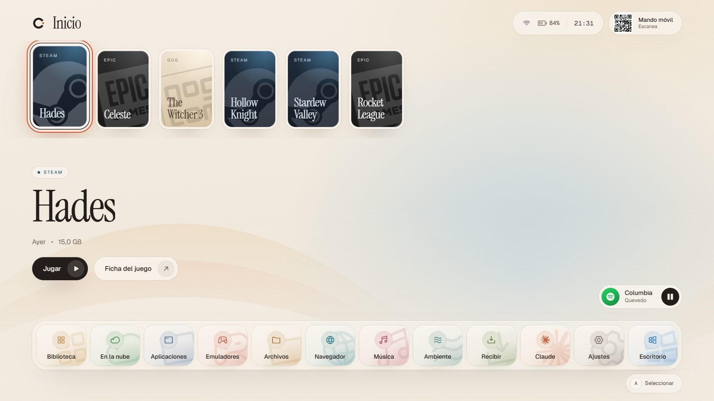

<div align="center">

[English](README.md) · **Español** · [Português (Brasil)](README.pt-BR.md) · [Français](README.fr.md) · [Deutsch](README.de.md) · [Italiano](README.it.md)

<br>

<picture>
  <source media="(prefers-color-scheme: dark)" srcset="brand/final/lockup-reversed.svg">
  
</picture>

### Modo consola gratis y de código abierto para Windows 10 y 11

Juegos de Steam, Epic, GOG y Xbox en una biblioteca, Xbox Cloud Gaming y PS5 Remote Play, emuladores y apps de streaming. Todo desde el sofá, con mando, teclado o el móvil.

[](https://github.com/pablonolascoo/couchdesk/releases/latest)
[](https://github.com/pablonolascoo/couchdesk/releases)
[](LICENSE)
[](https://github.com/pablonolascoo/couchdesk/releases/latest)
[](https://github.com/pablonolascoo/couchdesk/stargazers)

[**Descargar para Windows**](https://github.com/pablonolascoo/couchdesk/releases/latest) · [Web](https://pablonolascoo.github.io/couchdesk/) · [Novedades](CHANGELOG.md)



</div>

## Qué es

CouchDesk cambia el escritorio de Windows por una pantalla de consola, como la de una PS5 o Steam Big Picture. Desde el sofá juegas, ves series y cambias ajustes sin tocar el ratón. Si quieres, el PC arranca directamente en CouchDesk en lugar del escritorio.

Es gratis, sin cuenta, sin anuncios y sin telemetría.

## Funciones

| | |
|---|---|
| **Una biblioteca de juegos** | Steam, Epic, GOG y Xbox / Game Pass juntos. Los juegos de EA, Ubisoft, Battle.net y otras tiendas salen del menú Inicio: pulsa «Marcar como juego». |
| **Todas tus apps** | Todo lo instalado en el PC, con su icono real. |
| **Juego en la nube** | Xbox Cloud Gaming a pantalla completa y PS5 Remote Play con [chiaki-ng](https://github.com/streetpea/chiaki-ng). |
| **Emuladores** | Se instalan y actualizan con un botón, con carpetas de juegos, BIOS y partidas para cada uno, y vuelta a la versión anterior si una nueva falla. |
| **Navegador con mando** | 24 accesos de streaming: Netflix, Prime Video, Disney+, HBO Max, DAZN, Movistar Plus+, YouTube, Twitch, Spotify y más. Mantén Esc o pulsa el botón Xbox para salir. |
| **El móvil como mando** | Escanea un QR y el móvil es un mando, un touchpad o un teclado. Cambia de modo solo. |
| **Mandos de verdad** | Xbox, PS4 y PS5, por cable o Bluetooth, todos a la vez. El touchpad de PlayStation hace de ratón. Perfiles de botones y teclado en pantalla. |
| **Música** | Spotify o cualquier reproductor: qué suena, pausa, siguiente y volumen por app, también por voz. |
| **Claude dentro** | El asistente Claude con voz, conversaciones guardadas, conectores (MCP) y extensiones, en una ventana flotante sobre el juego. |
| **Fondos y temas** | Fondos animados como los de PS5, o tu imagen, vídeo, enlace de YouTube o modelo 3D. Temas incluidos o los tuyos, con música de menú. |
| **Salvapantallas y modo ambiente** | Salvapantallas como el de Apple TV con reloj, fecha y tiempo, modo de bajo consumo, y puede sustituir al de Windows. Vídeos de chimenea, cascada y lluvia. |
| **Arranca en CouchDesk** | El PC enciende en CouchDesk en lugar del escritorio de Windows, y un botón lo deshace. |
| **Archivos** | Explorador de archivos y recepción desde el móvil u otro PC por el navegador, FTP o LocalSend, directos a las carpetas de cada emulador. |
| **Ajustes de Windows** | Sonido, brillo, energía y Wi-Fi con el mando. |
| **Idiomas** | Español, inglés, portugués de Brasil, francés, alemán e italiano, con traducciones de la comunidad. |

## ¿Por qué CouchDesk?

| | CouchDesk | Modo Xbox | Steam Big Picture | Playnite |
|---|---|---|---|---|
| Funciona en Windows 10 | Sí | No (Windows 11 24H2 o posterior) | Sí | Sí |
| Juegos de varias tiendas | Sí | Sí | Añadidos a mano | Sí, con extensiones |
| PS5 Remote Play | Sí | No | No | No incluido |
| Instala y actualiza emuladores | Sí | No | No | No |
| Móvil como mando | Sí | No | No | No |
| Arranca en lugar del escritorio | Sí | Sí | No | No |

Cada herramienta tiene sus puntos fuertes. Lee las comparativas: [frente al modo Xbox](https://pablonolascoo.github.io/couchdesk/comparativa/modo-xbox/) · [frente a Steam Big Picture](https://pablonolascoo.github.io/couchdesk/comparativa/steam-big-picture/) · [frente a Playnite](https://pablonolascoo.github.io/couchdesk/comparativa/playnite/).

## Instalar

1. Descarga el archivo que termina en `_x64-setup.exe` de la [última versión](https://github.com/pablonolascoo/couchdesk/releases/latest).
2. Ábrelo. Windows SmartScreen puede avisar porque el instalador aún no está firmado: pulsa **Más información → Ejecutar de todas formas**.
3. ¿Quieres que arranque al encender? Ve a **Ajustes → Arranque**.

Para volver al escritorio normal: **Escritorio → Volver al modo normal de Windows**, o desactívalo en **Ajustes → Arranque**.

Necesita Windows 10 u 11 de 64 bits.

## Atajos

| Para | Haz esto |
|---|---|
| Volver al inicio desde cualquier juego o app | Mantén **Esc**, pulsa el botón **Xbox** o **PS**, o **Inicio** en el mando del móvil |
| Abrir Claude sobre un juego | **Ctrl + Alt + Espacio**, o **View + Y** en el mando |
| Usar el mando como ratón y teclado en Windows | **START + BACK** (Xbox) u **OPTIONS + SHARE** (PlayStation) |

## Preguntas

**¿Es gratis de verdad?** Sí. Licencia MIT, sin cuenta, sin anuncios y sin telemetría.

**¿Descarga juegos, BIOS o claves?** No. Usa los de tus propias consolas y juegos.

**¿Sustituye a Windows?** No. Funciona sobre Windows. Si activas el arranque, ocupa el lugar del escritorio solo para tu usuario, y un botón lo deshace.

**¿Los mandos de PlayStation necesitan DS4Windows?** No. CouchDesk lee el DualSense y el DualShock 4 directamente. Dentro de los juegos, usa el soporte del propio juego o Steam Input.

## Colaborar

Los fallos y las ideas van a [Incidencias](https://github.com/pablonolascoo/couchdesk/issues). ¿Quieres CouchDesk en tu idioma? Lee [TRANSLATING.md](TRANSLATING.md).

Para desarrolladores: hecho con [Tauri 2](https://tauri.app) (Rust) y React 19.

```bash
npm install
npm run app:dev      # abrir en modo desarrollo
npm run app:build    # crear el instalador (src-tauri/target/release/bundle/nsis)
npm run site         # regenerar la web de docs/ desde site/
npm run release      # subir la versión, crear el instalador y publicarlo (hace falta Bun y GitHub CLI)
```

Antes de publicar, apunta los cambios en [CHANGELOG.md](CHANGELOG.md).

## Licencia

[MIT](LICENSE) · Hecho por Pablo Nolasco. Los nombres y logos de productos son marcas de sus dueños.
