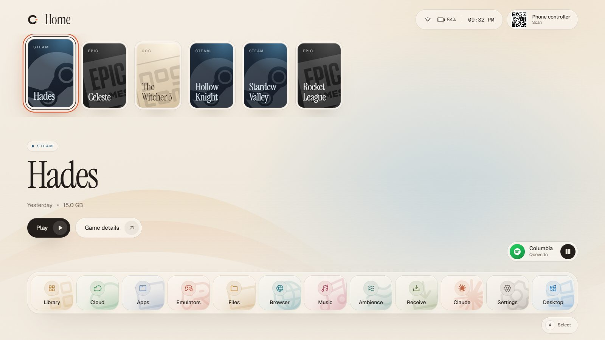

<div align="center">

[English](README.md) · [Español](README.es.md) · [Português (Brasil)](README.pt-BR.md) · **Français** · [Deutsch](README.de.md) · [Italiano](README.it.md)

<br>

<picture>
  <source media="(prefers-color-scheme: dark)" srcset="brand/final/lockup-reversed.svg">
  
</picture>

### Mode console gratuit et libre pour Windows 10 et 11

Des jeux Steam, Epic, GOG et Xbox dans une seule bibliothèque, Xbox Cloud Gaming et PS5 Remote Play, des émulateurs et des applications de streaming, le tout depuis le canapé avec une manette, le clavier ou votre smartphone.

[](https://github.com/pablonolascoo/couchdesk/releases/latest)
[](https://github.com/pablonolascoo/couchdesk/releases)
[](LICENSE)
[](https://github.com/pablonolascoo/couchdesk/releases/latest)
[](https://github.com/pablonolascoo/couchdesk/stargazers)

[**Télécharger pour Windows**](https://github.com/pablonolascoo/couchdesk/releases/latest) · [Site web](https://pablonolascoo.github.io/couchdesk/fr/) · [Journal des modifications](CHANGELOG.md)



</div>

## Ce que c'est

CouchDesk remplace le bureau Windows par un écran de style console, comme une PS5 ou Steam Big Picture. Depuis le canapé, vous jouez, regardez des séries et réglez tout sans toucher à la souris. Si vous le voulez, le PC démarre directement dessus à la place du bureau.

Il est gratuit, sans compte, sans publicité et sans télémétrie.

## Fonctions

| | |
|---|---|
| **Une seule bibliothèque de jeux** | Steam, Epic, GOG et Xbox / Game Pass réunis. Les jeux EA, Ubisoft, Battle.net et d'autres lanceurs viennent du menu Démarrer : appuyez sur « Marquer comme jeu ». |
| **Toutes vos applications** | Tout ce qui est installé sur le PC, avec sa vraie icône. |
| **Jeu dans le cloud** | Xbox Cloud Gaming en plein écran et PS5 Remote Play avec [chiaki-ng](https://github.com/streetpea/chiaki-ng). |
| **Émulateurs** | Installés et mis à jour en un bouton, avec des dossiers de jeux, de BIOS et de sauvegardes pour chacun, et retour en arrière si une nouvelle version pose problème. |
| **Navigateur à la manette** | 24 raccourcis de streaming : Netflix, Prime Video, Disney+, HBO Max, DAZN, Movistar Plus+, YouTube, Twitch, Spotify et d'autres. Maintenez Échap ou appuyez sur le bouton Xbox pour quitter. |
| **Smartphone comme manette** | Scannez un code QR et votre smartphone devient une manette, un pavé tactile ou un clavier. Il change de mode tout seul. |
| **Vraies manettes** | Xbox, PS4 et PS5, filaires ou Bluetooth, toutes en même temps. Le pavé tactile PlayStation fait office de souris. Profils d'association des boutons et clavier à l'écran. |
| **Musique** | Spotify ou n'importe quel lecteur : titre en cours, lecture/pause, suivant et volume par application, aussi à la voix. |
| **Claude intégré** | L'assistant Claude avec la voix, des conversations enregistrées, des connecteurs (MCP) et des extensions, dans une fenêtre flottante par-dessus votre jeu. |
| **Fonds et thèmes** | Des fonds animés dans le style PS5 ou votre propre image, vidéo, lien YouTube ou modèle 3D. Des thèmes intégrés, ou créez les vôtres avec une musique de menu. |
| **Écran de veille et mode ambiance** | Écran de veille dans le style d'Apple TV avec horloge, date et météo, mode basse consommation, et il peut remplacer celui de Windows. Vidéos de cheminée, de cascade et de pluie. |
| **Démarrer dans CouchDesk** | Démarrez le PC dans CouchDesk au lieu du bureau Windows, et revenez en arrière en un bouton. |
| **Fichiers** | Un explorateur de fichiers, et la réception de fichiers depuis votre smartphone ou un autre PC par envoi via le navigateur, FTP ou LocalSend, directement dans les dossiers des émulateurs. |
| **Réglages Windows** | Son, luminosité, alimentation et Wi-Fi à la manette. |
| **Langues** | Espagnol, anglais, portugais du Brésil, français, allemand et italien, avec des traductions de la communauté. |

## Pourquoi CouchDesk ?

| | CouchDesk | Mode Xbox | Steam Big Picture | Playnite |
|---|---|---|---|---|
| Fonctionne sous Windows 10 | Oui | Non (Windows 11 24H2+) | Oui | Oui |
| Jeux de plusieurs boutiques | Oui | Oui | Ajout manuel | Oui, avec des extensions |
| PS5 Remote Play | Oui | Non | Non | Non inclus |
| Installe et met à jour les émulateurs | Oui | Non | Non | Non |
| Smartphone comme manette | Oui | Non | Non | Non |
| Démarre à la place du bureau | Oui | Oui | Non | Non |

Chaque outil a ses points forts. Lisez les comparatifs honnêtes : [face au mode Xbox](https://pablonolascoo.github.io/couchdesk/fr/comparatif/mode-xbox/) · [face à Steam Big Picture](https://pablonolascoo.github.io/couchdesk/fr/comparatif/steam-big-picture/) · [face à Playnite](https://pablonolascoo.github.io/couchdesk/fr/comparatif/playnite/).

## Installation

1. Téléchargez le fichier qui se termine par `_x64-setup.exe` depuis la [dernière version](https://github.com/pablonolascoo/couchdesk/releases/latest).
2. Lancez-le. Windows SmartScreen peut vous avertir car l'installateur n'est pas encore signé : cliquez sur **Informations complémentaires → Exécuter quand même**.
3. Vous voulez qu'il démarre avec le PC ? Allez dans **Paramètres → Démarrage**.

Pour retrouver le bureau normal : **Bureau → Revenir au mode normal de Windows**, ou désactivez-le dans **Paramètres → Démarrage**.

Nécessite Windows 10 ou 11 en 64 bits.

## Raccourcis

| Pour | Faites ceci |
|---|---|
| Revenir à l'accueil depuis n'importe quel jeu ou application | Maintenez **Échap**, appuyez sur le bouton **Xbox** ou **PS**, ou appuyez sur **Accueil** sur la manette du smartphone |
| Ouvrir Claude par-dessus un jeu | **Ctrl + Alt + Espace**, ou **View + Y** sur la manette |
| Utiliser la manette comme souris et clavier dans Windows | **START + BACK** (Xbox) ou **OPTIONS + SHARE** (PlayStation) |

## FAQ

**Est-il vraiment gratuit ?** Oui. Licence MIT, sans compte, sans publicité, sans télémétrie.

**Télécharge-t-il des jeux, des BIOS ou des clés ?** Non. Utilisez ceux de vos propres consoles et jeux.

**Remplace-t-il Windows ?** Non. Il fonctionne par-dessus Windows. Si vous activez le mode démarrage, il prend la place du bureau pour votre utilisateur seulement, et un bouton l'annule.

**Les manettes PlayStation ont-elles besoin de DS4Windows ?** Non. CouchDesk lit directement la DualSense et la DualShock 4. Dans les jeux, utilisez la prise en charge du jeu ou Steam Input.

## Contribuer

Les rapports de bugs et les idées vont dans [Issues](https://github.com/pablonolascoo/couchdesk/issues). Vous voulez CouchDesk dans votre langue ? Lisez [TRANSLATING.md](TRANSLATING.md).

Pour les développeurs : construit avec [Tauri 2](https://tauri.app) (Rust) et React 19.

```bash
npm install
npm run app:dev      # run in development mode
npm run app:build    # build the installer (src-tauri/target/release/bundle/nsis)
npm run site         # rebuild the website in docs/ from site/
```

## Licence

[MIT](LICENSE) · Créé par Pablo Nolasco. Les noms de produits et les logos sont des marques de leurs propriétaires.
