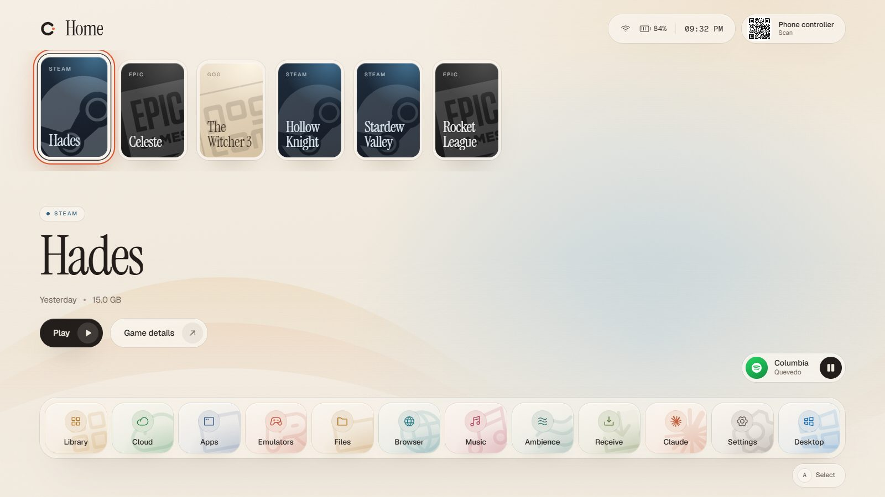

<div align="center">

[English](README.md) · [Español](README.es.md) · [Português (Brasil)](README.pt-BR.md) · [Français](README.fr.md) · [Deutsch](README.de.md) · **Italiano**

<br>

<picture>
  <source media="(prefers-color-scheme: dark)" srcset="brand/final/lockup-reversed.svg">
  
</picture>

### Modalità console gratuita e open source per Windows 10 e 11

Giochi Steam, Epic, GOG e Xbox in una sola libreria, Xbox Cloud Gaming e PS5 Remote Play, emulatori e app di streaming, tutto dal divano con un controller, la tastiera o lo smartphone.

[](https://github.com/pablonolascoo/couchdesk/releases/latest)
[](https://github.com/pablonolascoo/couchdesk/releases)
[](LICENSE)
[](https://github.com/pablonolascoo/couchdesk/releases/latest)
[](https://github.com/pablonolascoo/couchdesk/stargazers)

[**Scarica per Windows**](https://github.com/pablonolascoo/couchdesk/releases/latest) · [Sito web](https://pablonolascoo.github.io/couchdesk/it/) · [Novità](CHANGELOG.md)



</div>

## Cos'è

CouchDesk sostituisce il desktop di Windows con una schermata in stile console, come una PS5 o Steam Big Picture. Dal divano giochi, guardi serie e cambi le impostazioni senza toccare il mouse. Se vuoi, il PC si avvia direttamente in CouchDesk invece che sul desktop.

È gratis, senza account, senza pubblicità e senza telemetria.

## Funzioni

| | |
|---|---|
| **Una sola libreria di giochi** | Steam, Epic, GOG e Xbox / Game Pass insieme. I giochi di EA, Ubisoft, Battle.net e altri launcher arrivano dal menu Start: premi «Segna come gioco». |
| **Tutte le tue app** | Tutto ciò che è installato sul PC, con la sua vera icona. |
| **Gioco nel cloud** | Xbox Cloud Gaming a schermo intero e PS5 Remote Play con [chiaki-ng](https://github.com/streetpea/chiaki-ng). |
| **Emulatori** | Installati e aggiornati con un pulsante, con cartelle per giochi, BIOS e salvataggi per ognuno, e ripristino se una nuova versione dà problemi. |
| **Browser con il controller** | 24 collegamenti di streaming: Netflix, Prime Video, Disney+, HBO Max, DAZN, Movistar Plus+, YouTube, Twitch, Spotify e altri. Tieni premuto Esc o premi il tasto Xbox per uscire. |
| **Smartphone come controller** | Inquadra un codice QR e il telefono diventa un gamepad, un touchpad o una tastiera. Cambia modalità da solo. |
| **Controller veri** | Xbox, PS4 e PS5, con cavo o Bluetooth, tutti insieme. Il touchpad PlayStation funziona come un mouse. Profili di mappatura dei tasti e tastiera su schermo. |
| **Musica** | Spotify o qualsiasi lettore: brano in corso, play/pausa, avanti e volume per ogni app, anche a voce. |
| **Claude incluso** | L'assistente Claude con voce, conversazioni salvate, connettori (MCP) ed estensioni, in una finestra mobile sopra il tuo gioco. |
| **Sfondi e temi** | Sfondi animati in stile PS5 o una tua immagine, un video, un link YouTube o un modello 3D. Temi già pronti, oppure creane uno tuo con musica nei menu. |
| **Salvaschermo e modalità atmosfera** | Salvaschermo in stile Apple TV con orologio, data e meteo, modalità a basso consumo, e può sostituire quello di Windows. Video di camino, cascata e pioggia. |
| **Avvio in CouchDesk** | Avvia il PC in CouchDesk invece che sul desktop di Windows, e torna indietro con un pulsante. |
| **File** | Un esplora file, e ricevi file dal telefono o da un altro PC con upload dal browser, FTP o LocalSend, direttamente nelle cartelle degli emulatori. |
| **Impostazioni di Windows** | Audio, luminosità, alimentazione e Wi-Fi con il controller. |
| **Lingue** | Spagnolo, inglese, portoghese brasiliano, francese, tedesco e italiano, con traduzioni della community. |

## Perché CouchDesk?

| | CouchDesk | Modalità Xbox | Steam Big Picture | Playnite |
|---|---|---|---|---|
| Funziona su Windows 10 | Sì | No (Windows 11 24H2+) | Sì | Sì |
| Giochi da più negozi | Sì | Sì | Aggiunti a mano | Sì, con i componenti aggiuntivi |
| PS5 Remote Play | Sì | No | No | Non incluso |
| Installa e aggiorna gli emulatori | Sì | No | No | No |
| Smartphone come controller | Sì | No | No | No |
| Si avvia al posto del desktop | Sì | Sì | No | No |

Ogni strumento ha i suoi punti di forza. Leggi i confronti onesti: [contro la modalità Xbox](https://pablonolascoo.github.io/couchdesk/it/confronto/modalita-xbox/) · [contro Steam Big Picture](https://pablonolascoo.github.io/couchdesk/it/confronto/steam-big-picture/) · [contro Playnite](https://pablonolascoo.github.io/couchdesk/it/confronto/playnite/).

## Installazione

1. Scarica il file che finisce con `_x64-setup.exe` dall'[ultima versione](https://github.com/pablonolascoo/couchdesk/releases/latest).
2. Eseguilo. Windows SmartScreen potrebbe avvisarti perché l'installer non è ancora firmato: clicca **Ulteriori informazioni → Esegui comunque**.
3. Vuoi che parta con il PC? Vai in **Impostazioni → Avvio**.

Per riavere il desktop normale: **Desktop → Torna alla modalità normale di Windows**, oppure disattivalo in **Impostazioni → Avvio**.

Richiede Windows 10 o 11 a 64 bit.

## Scorciatoie

| Per | Fai così |
|---|---|
| Tornare alla Home da qualsiasi gioco o app | Tieni premuto **Esc**, premi il tasto **Xbox** o **PS**, oppure premi **Home** sul controller del telefono |
| Aprire Claude sopra un gioco | **Ctrl + Alt + Spazio**, oppure **View + Y** sul controller |
| Usare il controller come mouse e tastiera in Windows | **START + BACK** (Xbox) oppure **OPTIONS + SHARE** (PlayStation) |

## Domande frequenti

**È davvero gratis?** Sì. Licenza MIT, senza account, senza pubblicità, senza telemetria.

**Scarica giochi, file BIOS o chiavi?** No. Usa quelli delle tue console e dei tuoi giochi.

**Sostituisce Windows?** No. Funziona sopra Windows. Se attivi la modalità di avvio, prende il posto del desktop solo per il tuo utente, e un pulsante la annulla.

**I controller PlayStation hanno bisogno di DS4Windows?** No. CouchDesk legge direttamente DualSense e DualShock 4. Dentro i giochi, usa il supporto del gioco o Steam Input.

## Contribuire

Segnalazioni di errori e idee vanno in [Issues](https://github.com/pablonolascoo/couchdesk/issues). Vuoi CouchDesk nella tua lingua? Leggi [TRANSLATING.md](TRANSLATING.md).

Per gli sviluppatori: creato con [Tauri 2](https://tauri.app) (Rust) e React 19.

```bash
npm install
npm run app:dev      # run in development mode
npm run app:build    # build the installer (src-tauri/target/release/bundle/nsis)
npm run site         # rebuild the website in docs/ from site/
```

## Licenza

[MIT](LICENSE) · Creato da Pablo Nolasco. I nomi dei prodotti e i loghi sono marchi dei rispettivi proprietari.
