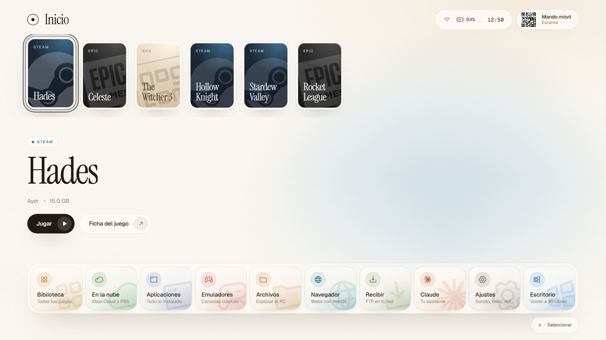
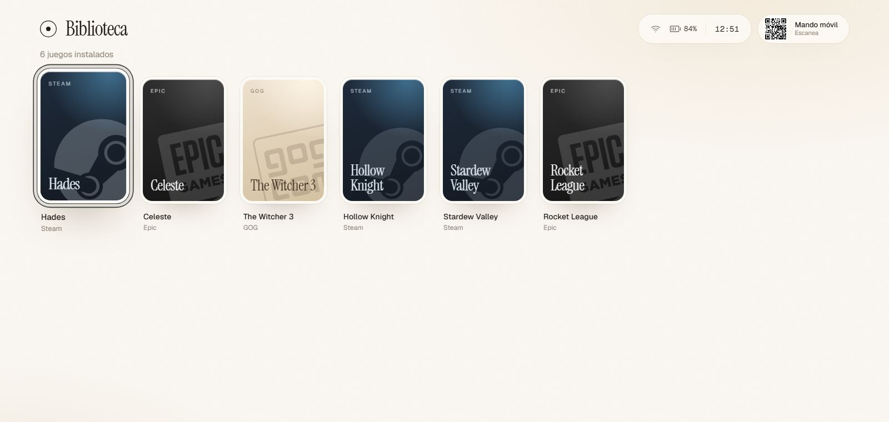
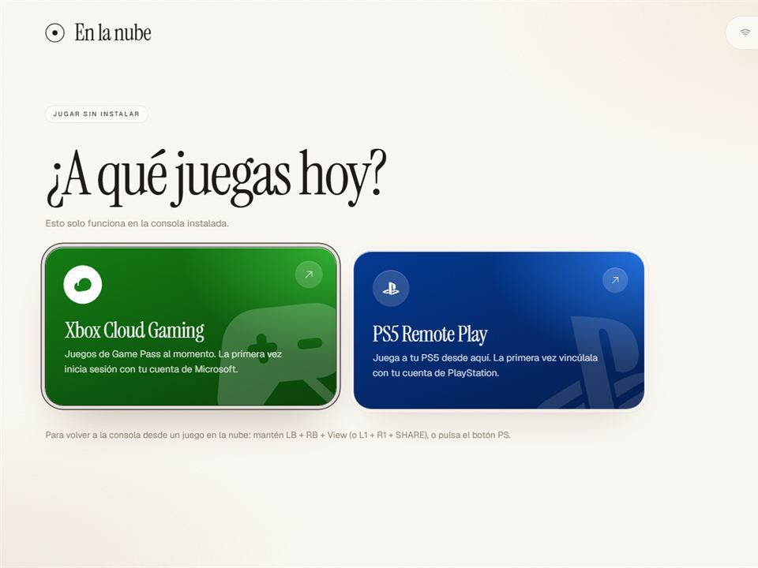
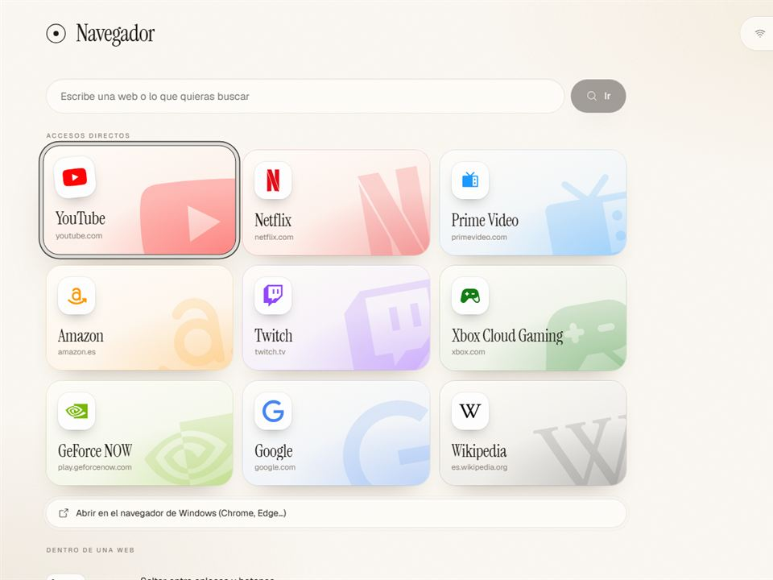
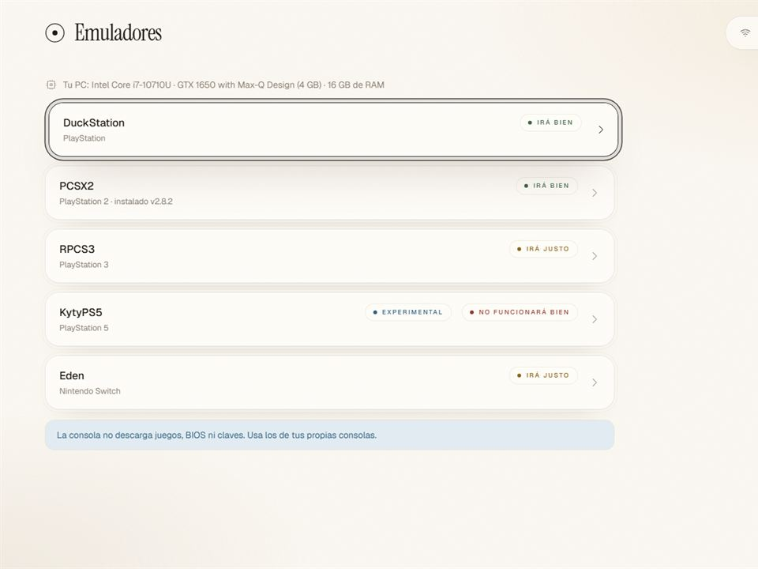
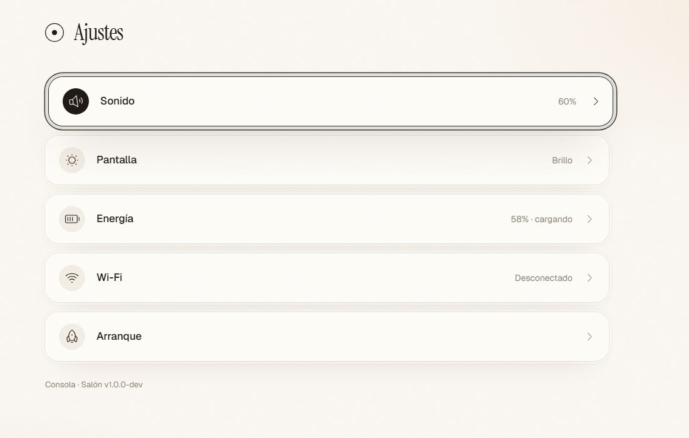

<div align="center">

# CouchDesk

**Tu PC con Windows en modo consola.**
Se maneja entero con mando, teclado o el móvil, como una PS5 o Steam Big Picture.

[](https://github.com/pablonolascoo/couchdesk/releases/latest)
[](LICENSE)
[](https://github.com/pablonolascoo/couchdesk/releases/latest)

[Web](https://pablonolascoo.github.io/couchdesk/) · [Descargar](https://github.com/pablonolascoo/couchdesk/releases/latest) · [Cambios](CHANGELOG.md)



</div>

## Qué es

CouchDesk cambia el escritorio de Windows por una pantalla como la de una consola. Desde el sofá juegas, ves series y cambias ajustes sin tocar el ratón. Si quieres, arranca en lugar del escritorio al encender el PC.

Es gratis y de código abierto.

## Funciones

| | Qué hace |
|---|---|
| 🎮 **Todos tus juegos juntos** | Steam, Epic, GOG, Xbox y Game Pass en una sola biblioteca. Si falta alguno, lo marcas como juego. |
| ☁️ **Juegos en la nube** | Xbox Cloud Gaming y PS5 Remote Play, dentro de la app. |
| 🕹️ **Emuladores** | Los instala y los actualiza. Cada uno trae botones para abrir la carpeta de juegos y la de BIOS. |
| 📺 **Series, deporte y música** | Netflix, Prime Video, Disney+, HBO Max, DAZN, Movistar Plus+, YouTube, Spotify y más, con su logo. |
| 🌐 **Navegador con mando** | La cruceta salta entre enlaces y el stick mueve la página. Esc o el botón Xbox te devuelven a casa. |
| 📱 **El móvil como mando** | Escaneas un QR y el móvil es un mando, un touchpad o un teclado. Cambia solo según lo que hagas. |
| 🎛️ **Mandos de verdad** | Xbox, PS4 y PS5 por cable o Bluetooth. El touchpad de PlayStation hace de ratón. |
| ⚡ **Arranca en lugar de Windows** | Al encender, ves CouchDesk y no el escritorio. Gasta menos memoria. |
| 🗂️ **Y además** | Todas tus apps con su icono, explorador de archivos, recibir archivos por FTP, sonido, brillo, Wi-Fi y energía. |

## Capturas

<table>
  <tr>
    <td width="50%"><br><b>Biblioteca.</b> Todos tus juegos, con su portada y su tienda.</td>
    <td width="50%"><br><b>En la nube.</b> Xbox Cloud Gaming y tu PS5 a distancia.</td>
  </tr>
  <tr>
    <td width="50%"><br><b>Navegador.</b> Accesos grandes a tus plataformas favoritas.</td>
    <td width="50%"><br><b>Emuladores.</b> Cada uno con su logo, sus carpetas y cómo irá en tu PC.</td>
  </tr>
  <tr>
    <td colspan="2"><br><b>Ajustes.</b> Sonido, pantalla, energía, Wi-Fi y arranque, todo con el mando.</td>
  </tr>
</table>

## Instalar

1. Descarga `Consola_X.Y.Z_x64-setup.exe` de la [última versión](https://github.com/pablonolascoo/couchdesk/releases/latest).
2. Ábrelo. Windows puede avisar de que no conoce el programa, porque aún no está firmado. Pulsa **Más información → Ejecutar de todas formas**.
3. ¿Quieres que arranque al encender? Ve a **Ajustes → Arranque**.

Para volver al escritorio normal: **Escritorio → Volver al modo normal de Windows**. Si algo falla, ejecuta `consola.exe --restaurar-escritorio`.

## Volver al inicio desde cualquier sitio

| Con | Haz esto |
|---|---|
| Mando de Xbox | Pulsa el botón **Xbox** |
| Mando de PlayStation | Pulsa el botón **PS** |
| Teclado | Mantén **Esc** 1 segundo, o púlsalo 3 veces |
| Móvil | Pulsa **Inicio** |

## Lo que no hace

No descarga juegos, BIOS ni claves. Usa los de tus propias consolas.

## Para desarrolladores

Hecho con [Tauri 2](https://tauri.app) (Rust) y React 19. Solo para Windows 10 y 11 de 64 bits.

```bash
npm install
npm run tauri dev      # abrir en modo desarrollo
npm run app:build      # crear el instalador (src-tauri/target/release/bundle/nsis)
cd src-tauri && cargo test --lib
```

### Publicar una versión

Cada versión tiene número ([SemVer](https://semver.org/lang/es/)) y nombre en clave. La primera es **Salón v1.0.0**. Hace falta [Bun](https://bun.sh) y [GitHub CLI](https://cli.github.com).

```bash
npm run release          # 1.0.0 → 1.0.1
npm run release minor    # 1.0.1 → 1.1.0
npm run release major    # 1.1.0 → 2.0.0
```

El script sube la versión, crea el instalador y lo publica en GitHub. También avisa a los buscadores (IndexNow). Si algo falla al compilar, lo deja todo como estaba. Antes, apunta los cambios en [CHANGELOG.md](CHANGELOG.md).

## Licencia

[MIT](LICENSE) · Hecho por Pablo Nolasco.
