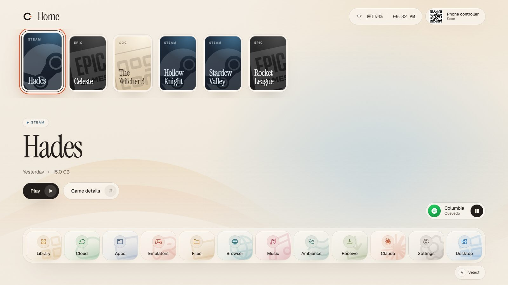

<div align="center">

**English** · [Español](README.es.md) · [Português (Brasil)](README.pt-BR.md) · [Français](README.fr.md) · [Deutsch](README.de.md) · [Italiano](README.it.md)

<br>

<picture>
  <source media="(prefers-color-scheme: dark)" srcset="brand/final/lockup-reversed.svg">
  
</picture>

### Free, open-source console mode for Windows 10 and 11

Steam, Epic, GOG and Xbox games in one library, Xbox Cloud Gaming and PS5 Remote Play, emulators and streaming apps, all run from the couch with a controller, the keyboard or your phone.

[](https://github.com/pablonolascoo/couchdesk/releases/latest)
[](https://github.com/pablonolascoo/couchdesk/releases)
[](LICENSE)
[](https://github.com/pablonolascoo/couchdesk/releases/latest)
[](https://github.com/pablonolascoo/couchdesk/stargazers)

[**Download for Windows**](https://github.com/pablonolascoo/couchdesk/releases/latest) · [Website](https://pablonolascoo.github.io/couchdesk/en/) · [Changelog](CHANGELOG.md)



</div>

## What it is

CouchDesk replaces the Windows desktop with a console-style screen, like a PS5 or Steam Big Picture. From the couch you play, watch shows and change settings without touching the mouse. If you want, the PC boots straight into it instead of the desktop.

It's free, has no account, no ads and no telemetry.

## Features

| | |
|---|---|
| **One game library** | Steam, Epic, GOG and Xbox / Game Pass together. Games from EA, Ubisoft, Battle.net and other launchers come from the Start menu: press "Mark as game". |
| **All your apps** | Everything installed on the PC, with its real icon. |
| **Cloud gaming** | Xbox Cloud Gaming in full screen and PS5 Remote Play with [chiaki-ng](https://github.com/streetpea/chiaki-ng). |
| **Emulators** | Installed and updated with one button, with game, BIOS and save folders for each one, and rollback if a new version breaks. |
| **Browser with a controller** | 24 streaming shortcuts: Netflix, Prime Video, Disney+, HBO Max, DAZN, Movistar Plus+, YouTube, Twitch, Spotify and more. Hold Esc or press the Xbox button to leave. |
| **Phone as a controller** | Scan a QR code and your phone becomes a gamepad, touchpad or keyboard. It switches mode by itself. |
| **Real controllers** | Xbox, PS4 and PS5, wired or Bluetooth, all at once. The PlayStation touchpad works as a mouse. Button mapping profiles and an on-screen keyboard. |
| **Music** | Spotify or any player: now playing, play/pause, next and per-app volume, also by voice. |
| **Claude built in** | The Claude assistant with voice, saved conversations, connectors (MCP) and extensions, in a floating window over your game. |
| **Backgrounds and themes** | Animated PS5-style backgrounds or your own image, video, YouTube link or 3D model. Built-in themes, or make your own with menu music. |
| **Screensaver and ambient mode** | Apple TV-style screensaver with clock, date and weather, low-power mode, and it can replace the Windows one. Fireplace, waterfall and rain videos. |
| **Boot into CouchDesk** | Start the PC in CouchDesk instead of the Windows desktop, and go back with one button. |
| **Files** | A file explorer, and receive files from your phone or another PC by browser upload, FTP or LocalSend, straight into emulator folders. |
| **Windows settings** | Sound, brightness, power and Wi-Fi with the controller. |
| **Languages** | Spanish, English, Brazilian Portuguese, French, German and Italian, with community translations. |

## Why CouchDesk?

| | CouchDesk | Xbox mode | Steam Big Picture | Playnite |
|---|---|---|---|---|
| Runs on Windows 10 | Yes | No (Windows 11 24H2+) | Yes | Yes |
| Games from several stores | Yes | Yes | Added by hand | Yes, with add-ons |
| PS5 Remote Play | Yes | No | No | Not included |
| Installs and updates emulators | Yes | No | No | No |
| Phone as a controller | Yes | No | No | No |
| Boots instead of the desktop | Yes | Yes | No | No |

Each tool has its strengths. Read the honest comparisons: [vs Xbox mode](https://pablonolascoo.github.io/couchdesk/en/vs/xbox-mode/) · [vs Steam Big Picture](https://pablonolascoo.github.io/couchdesk/en/vs/steam-big-picture/) · [vs Playnite](https://pablonolascoo.github.io/couchdesk/en/vs/playnite/).

## Install

1. Download the file ending in `_x64-setup.exe` from the [latest release](https://github.com/pablonolascoo/couchdesk/releases/latest).
2. Run it. Windows SmartScreen may warn you because the installer isn't signed yet: click **More info → Run anyway**.
3. Want it to start with the PC? Go to **Settings → Startup**.

To get the normal desktop back: **Desktop → Go back to normal Windows mode**, or turn it off in **Settings → Startup**.

Requires 64-bit Windows 10 or 11.

## Shortcuts

| To | Do this |
|---|---|
| Go back home from any game or app | Hold **Esc**, press the **Xbox** or **PS** button, or press **Home** on the phone controller |
| Open Claude over a game | **Ctrl + Alt + Space**, or **View + Y** on the controller |
| Use the controller as mouse and keyboard in Windows | **START + BACK** (Xbox) or **OPTIONS + SHARE** (PlayStation) |

## FAQ

**Is it really free?** Yes. MIT license, no account, no ads, no telemetry.

**Does it download games, BIOS files or keys?** No. Use the ones from your own consoles and games.

**Does it replace Windows?** No. It runs on top of Windows. If you turn on boot mode, it takes the desktop's place for your user only, and one button undoes it.

**Do PlayStation controllers need DS4Windows?** No. CouchDesk reads the DualSense and DualShock 4 directly. Inside games, use the game's own support or Steam Input.
## Contributing

Bug reports and ideas go to [Issues](https://github.com/pablonolascoo/couchdesk/issues). Want CouchDesk in your language? Read [TRANSLATING.md](TRANSLATING.md).

For developers: built with [Tauri 2](https://tauri.app) (Rust) and React 19.

```bash
npm install
npm run app:dev      # run in development mode
npm run app:build    # build the installer (src-tauri/target/release/bundle/nsis)
npm run site         # rebuild the website in docs/ from site/
npm run release      # bump the version, build the installer and publish it (needs Bun and GitHub CLI)
```

Before a release, add the changes to [CHANGELOG.md](CHANGELOG.md).

## License

[MIT](LICENSE) · Made by Pablo Nolasco. Product names and logos are trademarks of their owners.
