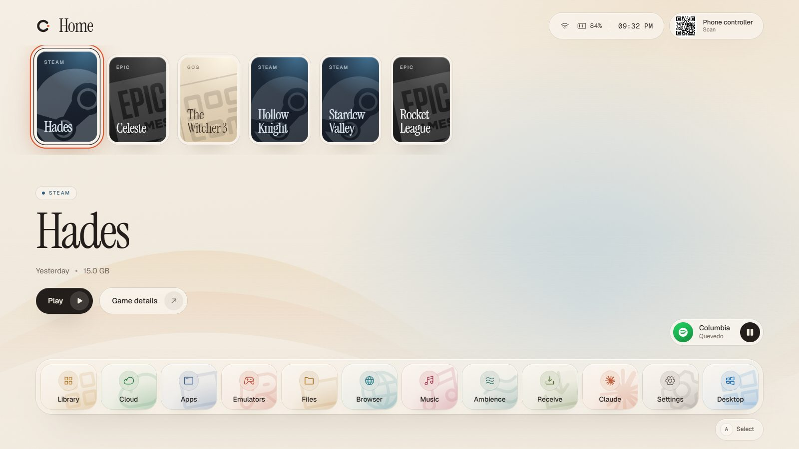

<div align="center">

[English](README.md) · [Español](README.es.md) · **Português (Brasil)** · [Français](README.fr.md) · [Deutsch](README.de.md) · [Italiano](README.it.md)

<br>

<picture>
  <source media="(prefers-color-scheme: dark)" srcset="brand/final/lockup-reversed.svg">
  
</picture>

### Modo console grátis e de código aberto para Windows 10 e 11

Jogos da Steam, Epic, GOG e Xbox numa biblioteca só, Xbox Cloud Gaming e PS5 Remote Play, emuladores e aplicativos de streaming, tudo direto do sofá, com um controle, o teclado ou o celular.

[](https://github.com/pablonolascoo/couchdesk/releases/latest)
[](https://github.com/pablonolascoo/couchdesk/releases)
[](LICENSE)
[](https://github.com/pablonolascoo/couchdesk/releases/latest)
[](https://github.com/pablonolascoo/couchdesk/stargazers)

[**Baixar para Windows**](https://github.com/pablonolascoo/couchdesk/releases/latest) · [Site](https://pablonolascoo.github.io/couchdesk/pt-br/) · [Novidades](CHANGELOG.md)



</div>

## O que é

O CouchDesk troca a área de trabalho do Windows por uma tela no estilo de console, como a de um PS5 ou do Steam Big Picture. Do sofá, você joga, assiste a séries e muda configurações sem tocar no mouse. Se quiser, o PC inicia direto nele, no lugar da área de trabalho.

É grátis, sem conta, sem anúncios e sem telemetria.

## Recursos

| | |
|---|---|
| **Uma biblioteca de jogos** | Steam, Epic, GOG e Xbox / Game Pass juntos. Jogos da EA, Ubisoft, Battle.net e de outros launchers vêm do menu Iniciar: aperte “Marcar como jogo”. |
| **Todos os seus aplicativos** | Tudo o que está instalado no PC, com o ícone de verdade. |
| **Jogos na nuvem** | Xbox Cloud Gaming em tela cheia e PS5 Remote Play com o [chiaki-ng](https://github.com/streetpea/chiaki-ng). |
| **Emuladores** | Instalados e atualizados com um botão, com pastas de jogos, BIOS e saves para cada um, e volta à versão anterior se uma nova der problema. |
| **Navegador com controle** | 24 atalhos de streaming: Netflix, Prime Video, Disney+, HBO Max, DAZN, Movistar Plus+, YouTube, Twitch, Spotify e mais. Segure Esc ou aperte o botão Xbox para sair. |
| **Celular como controle** | Escaneie um QR code e o celular vira um gamepad, touchpad ou teclado. Ele troca de modo sozinho. |
| **Controles de verdade** | Xbox, PS4 e PS5, com fio ou Bluetooth, todos ao mesmo tempo. O touchpad do PlayStation funciona como mouse. Perfis de mapeamento de botões e teclado na tela. |
| **Música** | Spotify ou qualquer player: o que está tocando, tocar/pausar, próxima e volume por aplicativo, também por voz. |
| **Claude já incluído** | O assistente Claude com voz, conversas salvas, conectores (MCP) e extensões, numa janela flutuante sobre o seu jogo. |
| **Fundos e temas** | Fundos animados no estilo do PS5 ou sua própria imagem, vídeo, link do YouTube ou modelo 3D. Temas incluídos, ou crie o seu com música no menu. |
| **Protetor de tela e modo ambiente** | Protetor de tela no estilo Apple TV com relógio, data e clima, modo de baixo consumo, e pode substituir o do Windows. Vídeos de lareira, cachoeira e chuva. |
| **Iniciar no CouchDesk** | Ligue o PC no CouchDesk em vez da área de trabalho do Windows, e volte com um botão. |
| **Arquivos** | Um explorador de arquivos, e receba arquivos do celular ou de outro PC por envio pelo navegador, FTP ou LocalSend, direto nas pastas dos emuladores. |
| **Configurações do Windows** | Som, brilho, energia e Wi-Fi com o controle. |
| **Idiomas** | Espanhol, inglês, português do Brasil, francês, alemão e italiano, com traduções da comunidade. |

## Por que o CouchDesk?

| | CouchDesk | Modo Xbox | Steam Big Picture | Playnite |
|---|---|---|---|---|
| Roda no Windows 10 | Sim | Não (Windows 11 24H2+) | Sim | Sim |
| Jogos de várias lojas | Sim | Sim | Adicionados à mão | Sim, com complementos |
| PS5 Remote Play | Sim | Não | Não | Não incluído |
| Instala e atualiza emuladores | Sim | Não | Não | Não |
| Celular como controle | Sim | Não | Não | Não |
| Inicia no lugar da área de trabalho | Sim | Sim | Não | Não |

Cada ferramenta tem seus pontos fortes. Leia as comparações honestas: [vs modo Xbox](https://pablonolascoo.github.io/couchdesk/pt-br/comparacao/modo-xbox/) · [vs Steam Big Picture](https://pablonolascoo.github.io/couchdesk/pt-br/comparacao/steam-big-picture/) · [vs Playnite](https://pablonolascoo.github.io/couchdesk/pt-br/comparacao/playnite/).

## Instalação

1. Baixe o arquivo que termina em `_x64-setup.exe` na [última versão](https://github.com/pablonolascoo/couchdesk/releases/latest).
2. Execute o arquivo. O Windows SmartScreen pode avisar porque o instalador ainda não é assinado: clique em **Mais informações → Executar assim mesmo**.
3. Quer que ele inicie com o PC? Vá em **Configurações → Inicialização**.

Para voltar à área de trabalho normal: **Área de trabalho → Voltar ao modo normal do Windows**, ou desative em **Configurações → Inicialização**.

Requer Windows 10 ou 11 de 64 bits.

## Atalhos

| Para | Faça isto |
|---|---|
| Voltar ao início de qualquer jogo ou aplicativo | Segure **Esc**, aperte o botão **Xbox** ou **PS**, ou toque em **Início** no controle do celular |
| Abrir o Claude sobre um jogo | **Ctrl + Alt + Espaço**, ou **View + Y** no controle |
| Usar o controle como mouse e teclado no Windows | **START + BACK** (Xbox) ou **OPTIONS + SHARE** (PlayStation) |

## Perguntas frequentes

**É grátis mesmo?** Sim. Licença MIT, sem conta, sem anúncios, sem telemetria.

**Ele baixa jogos, arquivos de BIOS ou chaves?** Não. Use os dos seus próprios consoles e jogos.

**Ele substitui o Windows?** Não. Ele roda por cima do Windows. Se você ativar o modo de inicialização, ele toma o lugar da área de trabalho só para o seu usuário, e um botão desfaz.

**Os controles de PlayStation precisam do DS4Windows?** Não. O CouchDesk lê o DualSense e o DualShock 4 diretamente. Dentro dos jogos, use o suporte do próprio jogo ou o Steam Input.

## Como contribuir

Relatos de erros e ideias vão em [Issues](https://github.com/pablonolascoo/couchdesk/issues). Quer o CouchDesk no seu idioma? Leia o [TRANSLATING.md](TRANSLATING.md).

Para desenvolvedores: feito com [Tauri 2](https://tauri.app) (Rust) e React 19.

```bash
npm install
npm run app:dev      # run in development mode
npm run app:build    # build the installer (src-tauri/target/release/bundle/nsis)
npm run site         # rebuild the website in docs/ from site/
```

## Licença

[MIT](LICENSE) · Feito por Pablo Nolasco. Nomes de produtos e logotipos são marcas registradas de seus donos.
